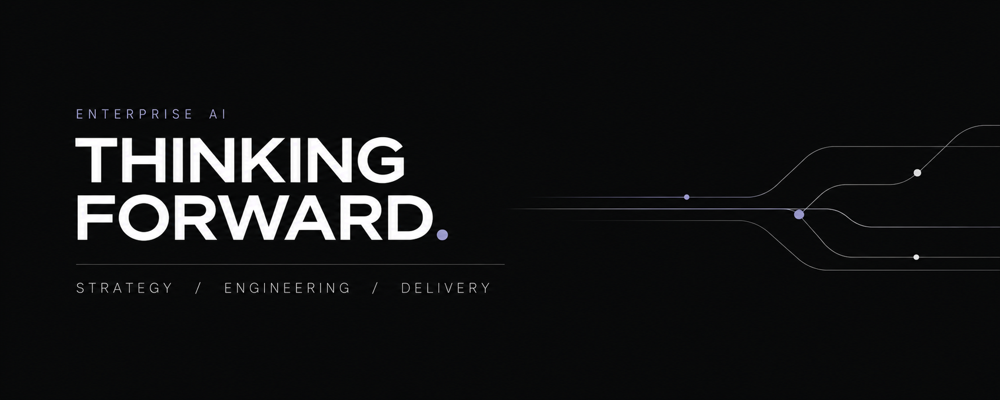

### We make AI work inside your business.

**Thinking Forward** is an enterprise AI practice combining **strategy, architecture, engineering and hands-on delivery**. We identify where AI can create measurable value, build agents and workflows into existing systems, and train teams to operate what we deliver.

Our senior practitioners work across the full journey — **from business problem to working implementation and handover.**

## What we do

**AI strategy & architecture**  
Assess opportunities, define the business case, prioritise use cases and design the architecture for implementation.

**Agentic AI & systems engineering**  
Build and integrate AI agents, automation and multi-step workflows using approved data, APIs, enterprise tools and MCP where appropriate.

**Evaluation, controls & delivery**  
Test real workflows for quality and failure modes; design access controls, human approvals, observability and operating procedures.

**Training & team enablement**  
Deliver practical executive and engineering workshops, reusable Agent Skills, documentation and knowledge transfer.

## How we work

**Discover → Design → Build & Integrate → Evaluate → Enable**

Our approach is built around deliverables, not slide decks: a clearly scoped use case, working technology, evidence from testing, documented limitations and an accountable owner on the client's side. The exact deliverables depend on the agreed project scope.

## Open engineering & research

We publish selected research, tools and reference architectures to make applied AI engineering easier to inspect and reproduce.

**[UAE Business Skills](https://github.com/thinkingforwardai/uae-business-skills)**  
Research into UAE government-service information, public APIs, community MCP servers, entity relationships and multi-step Agent Skills. The current work is a research foundation; proposed workflows are not automatically released or authorised government integrations.

Our broader Open Labs work will explore the same methods for enterprise workflows and additional GCC markets, including Saudi Arabia and Qatar.

## Work with us

**[Website](https://thinkingforward.ai/)** · **[Corporate AI Training](https://thinkingforward.ai/trainings/)** · **[Explore our repositories](https://github.com/orgs/thinkingforwardai/repositories)** · **[Email us](mailto:office@thinkingforward.ai)**

*Senior-led AI strategy, engineering and delivery · Middle East & Europe*
